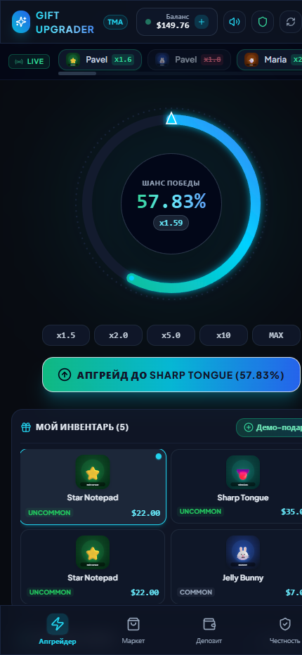

# 🎁 NFT Gift Upgrader — Telegram Mini App (TMA)

Премиальный CS2-style Upgrader для лимитированных NFT-подарков Telegram в неоновом стиле Fragment / Cyberpunk Dark.



---

## ⚡ Особенности и Стек

- **Frontend**: React 18, TypeScript, Vite, TailwindCSS, Framer Motion, Canvas Confetti, Lucide Icons.
- **Backend**: Node.js, Fastify, TypeScript, Prisma ORM, SQLite (`packages/server/prisma/dev.db`), crypto.
- **Shared Package**: Единый пакет `@upgrader/shared` с типами, DTO и криптографически чистой математикой Provably Fair.
- **Audio Engine**: Чистый Web Audio API аудио-синтезатор звуков (щелчки вращения колеса, победный аккорд, звук сгорания, переключатель Mute).
- **Telegram Mini App**:
  - Полная валидация `initData` по алгоритму HMAC-SHA256 с токеном бота.
  - Автоматический Dev-режим для тестирования в браузере без Telegram.
  - Тактильная отдача (Telegram Haptic Feedback: `impactOccurred`, `notificationOccurred`).
  - Темы и полноэкранный режим (`tg.expand()`).

---

## 🎲 Математика и Provably Fair

### 1. Формула шанса и защита от абуза (1.0% - 80.0%)
$$ \text{Raw Chance} = \frac{\text{Price}_{\text{source}}}{\text{Price}_{\text{target}}} \times (1 - 0.08) \times 100 $$
- **House Edge**: 8% (множитель `0.92`).
- **Строгий лимит**: Если $\text{Raw Chance} < 1.0\%$ или $\text{Raw Chance} > 80.0\%$, операция **блокируется** как на клиенте, так и на бэкенде с HTTP 400 (`isValid: false`). Принудительный min/max clamp не используется.

### 2. Криптографическая честность (Commitment Scheme)
1. **Server Seed**: 64-символьная криптографически стойкая hex-строка (`crypto.randomBytes(32)`).
2. **Commitment (Хеш сервера)**: $\text{SHA256}(\text{serverSeed})$ публикуется игроку **ДО** броска.
3. **Roll**:
   $$ \text{HMAC} = \text{HMAC\_SHA256}(\text{serverSeed}, \, \text{clientSeed} + ":" + \text{nonce}) $$
   Первые 8 hex-символов переводятся в 32-битное число и делятся на `0xFFFFFFFF`, давая `roll` от $0.0000\%$ до $99.9999\%$.
4. **Угол колеса**: $\text{Angle} = 360^\circ \times \frac{\text{roll}}{100}$.
5. **Ротация сида**: На каждый бросок сервер **раскрывает** старый `serverSeed` в историю и генерирует новый `serverSeedHash`.
6. **Интерактивный верификатор**: На вкладке "Честность" любой игрок может проверить любой прошлый бросок прямо в браузере.

---

## 🚀 Запуск проекта

### 1. Установка зависимостей
```bash
npm install
```

### 2. База данных и наполнение подарками
```bash
# Применение схемы Prisma
npm run db:push

# Заполнение 18 реальными Telegram подарками и тестовыми данными
npm run db:seed
```

### 3. Запуск серверов
```bash
# Запуск бэкенда (порт 3001)
npm run dev:server

# Запуск фронтенда (порт 3000)
npm run dev:client
```
Приложение откроется на: [http://localhost:3000](http://localhost:3000)

### 4. Запуск автотестов API и Provably Fair
```bash
npm run test --workspace=@upgrader/server
```

---

## 📱 Структура монорепозитория

```
krutekazino/
├── package.json                   # Workspaces: ["packages/*"]
├── packages/
│   ├── shared/                    # Общий код: типы, константы, формулы
│   │   ├── src/provablyFair.ts    # Изоморфный SHA-256 / HMAC / проверка roll
│   │   ├── src/constants.ts       # HOUSE_EDGE, лимиты, палитры редкостей
│   │   └── src/types.ts           # DTOs
│   │
│   ├── server/                    # Fastify + Prisma + SQLite
│   │   ├── prisma/schema.prisma   # Схема базы данных
│   │   ├── prisma/seed.ts         # 18 Telegram NFT подарков с SVG
│   │   └── src/
│   │       ├── server.ts          # Сервер Fastify (:3001)
│   │       ├── middleware/auth.ts # Telegram HMAC-SHA256 валидация + Dev-режим
│   │       ├── routes/            # auth, gifts, inventory, upgrade
│   │       └── test-api.ts        # 26 E2E автотестов
│   │
│   └── client/                    # React 18 + Vite + TailwindCSS
│       ├── src/components/
│       │   ├── UpgradeWheel.tsx   # SVG-колесо с неоновым свечением и стрелкой
│       │   ├── LiveDropsBar.tsx   # Бегущая строка Live выигрышей
│       │   ├── InventorySelector.tsx # Выбор предмета + Демо-подарок
│       │   ├── TargetCatalogSelector.tsx # Выбор цели с расчетом шанса
│       │   ├── WinCelebrationModal.tsx # Модалка победы с конфетти
│       │   ├── BottomNavBar.tsx   # Нижняя навигация на 4 экрана
│       │   ├── InventoryShopScreen.tsx # Маркет и быстрая продажа за 95%
│       │   ├── DepositScreen.tsx  # Депозит через Telegram Бота и TON
│       │   ├── ProvablyFairScreen.tsx # Интерактивный калькулятор честности
│       │   └── DevToolbar.tsx     # Панель быстрого теста
│       └── src/services/soundEngine.ts # Web Audio API синтезатор
```
